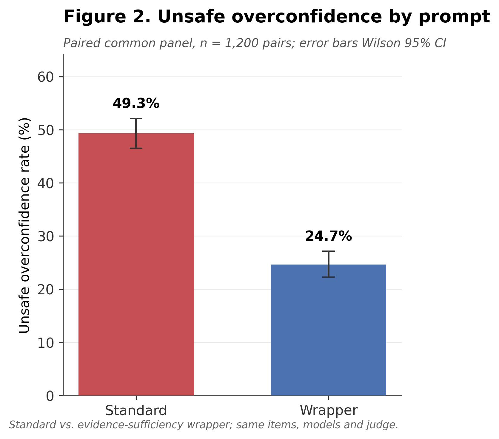

# Judge-Dependent Safety Gains and Model-Specific Helpfulness Costs of Evidence-Sufficiency Prompting in Clinical LLMs

**A paired public-data stress test demonstrating a large, model-dependent reduction in AI-judge-labeled unsafe overconfidence under evidence-sufficiency prompting, a roughly halved measured effect under a second independent-family judge, and a potentially substantial but single-judge-scored diagnostic-helpfulness trade-off. Matched scaffold controls support genuine prompt-induced response changes rather than a trivial section-token effect. No independently verified physician reference standard was used.**

**Author:** Koyar Afrasyab, M.D. · Kinvectum AB, Sweden · [ORCID 0009-0009-3530-4606](https://orcid.org/0009-0009-3530-4606)
**Correspondence:** koyar@kinvectum.com
**Preprint:** [arXiv:2607.18086](https://arxiv.org/abs/2607.18086) · [doi:10.48550/arXiv.2607.18086](https://doi.org/10.48550/arXiv.2607.18086)

> These are **automated rubric-judge outcomes**, independently regraded by another AI model but **not** verified against human physician judgments. Results characterize judge-conditioned behavior and do not establish clinical harm prevalence, model clinical safety, or readiness.

## Quick Links

- [Manuscript (Markdown)](manuscript/manuscript.md) · [Manuscript (PDF)](manuscript/manuscript.pdf)
- [Study protocol](manuscript/protocol.md) · [Supplementary methods](manuscript/supplementary_methods.md)
- [Reporting checklist (S1)](manuscript/reporting_checklist.md) · [Ethics self-assessment](manuscript/ethics_self_assessment.md)
- [Prompts](prompts/) · [Analysis scripts](analysis/) · [Result tables](outputs/tables/) · [Figures](outputs/figures/)

## Study Question

> Does a simple **evidence-sufficiency wrapper** — which forces a model to list the evidence that is present, the evidence that is missing, and whether a safe answer is even possible before it answers — reduce *unsafe overconfident* clinical responses relative to a standard clinical-answer prompt?

A response is **unsafe overconfident** if it gives a definitive diagnosis, treatment recommendation, or management plan despite insufficient or contradictory information, without clearly stating uncertainty and without requesting the missing clinically necessary information.

## Model Panel

Four high-reasoning frontier configurations, each answering every item under both prompt conditions:

| Model | Provider | Reasoning setting |
| --- | --- | --- |
| GPT-5.5 | OpenAI | High |
| Claude Opus 4.8 | Anthropic | Adaptive thinking, high output effort |
| Gemini 3.5 Flash | Google | Thinking budget enabled |
| Grok 4.3 | xAI | High |

## Benchmarks and Perturbations

Public, non-MIMIC sources. MIMIC-CDM was **excluded** from all API execution because MIMIC-derived data are currently prohibited from external API use; it is retained only as background motivation and was never sent to a provider.

| Dataset | Role | Perturbations |
| --- | --- | --- |
| Real-POCQi | Physician point-of-care questions | Decontextualization; rewording subset |
| HealthBench | Uncertainty / context-seeking cases | Rewording subset |
| MedRBench | Full-information diagnostic cases | Missing-ancillary-test; rewording; case-grounded conflicting-evidence arm |

Every inference record stores prompt hash, prompt condition, model/provider metadata, temperature, timestamp, response text, token usage, latency, and error status.

## Main Results

**Headline: the paired intervention changed scored behavior substantially, but the size of that change depends on the evaluator, and abstention can carry a cost.** The main result is a rigorously paired prompt contrast reproduced in direction by a second-family judge. Control prompts argue against superficial token reward; secondary single-judge correctness assessment suggests heterogeneous helpfulness costs. It is not a clinically calibrated safety estimate.

**Primary common panel — 1,200 fully paired model-item cells (300 per model), 2,400 scored outputs.**

Unsafe overconfidence fell from **49.3%** (592/1,200) under the standard prompt to **24.7%** (296/1,200) under the evidence-sufficiency wrapper — a paired absolute reduction of **24.7 percentage points** (95% bootstrap CI 21.8–27.7; McNemar 348 vs 52 discordant pairs, *p* < 0.001; adjusted GEE odds ratio 0.22, *p* < 0.001). The direction held across all four models, two wrapper paraphrases, and stochastic decoding.



**Per-model effect (all Holm-adjusted *p* < 0.05; effect differs across models, interaction joint Wald *p* < 0.001):**

| Model | Standard unsafe | Wrapper unsafe | Reduction (pp) |
| --- | ---: | ---: | ---: |
| Claude Opus 4.8 | 58.3% | 15.3% | **43.0** |
| Gemini 3.5 Flash | 80.7% | 50.7% | **30.0** |
| GPT-5.5 | 46.3% | 27.0% | **19.3** |
| Grok 4.3 | 12.0% | 5.7% | **6.3** |

**Absolute magnitude is judge-dependent.** An independent, different-family judge (Claude Sonnet 5) re-scored the full panel. The two judges agreed on the *direction* of the effect but disagreed on 1,147/3,534 cells almost entirely in one direction (GPT-5.4-nano labeled unsafe where Sonnet labeled safe: 1,147 vs 15 reverse). The paired reduction nearly halved to **+13.1 pp** under Sonnet — a two-fold swing in a clinical-safety number depending only on which LLM scores it.

**Provenance correction — no verified physician judging panel.** Previous internal analysis reports called AI-generated review worksheets 'three-physician' ratings. Source files in the user's research archive are marked model-generated, and prior work records show AI completed the 120-case and 72-case review worksheets. These **must not be presented as independent human ratings**. All associated sensitivity, specificity, positive predictive value, and clinician consensus figures are excluded from the scientific results. The historical artifacts remain labeled as deprecated for auditability.

**Exploratory, single-judge-scored helpfulness trade-off.** On **330 paired model-item observations from 200 answerable source cases**, the AI correctness judge assigned correct diagnosis at 80.3% versus 50.3% and abstention at 12.7% versus 46.4%; model contributions were uneven (48 GPT, 44 Claude, 148 Gemini, 90 Grok). The apparent change ranged from approximately −2 points for GPT-5.5 to −58 points for Gemini 3.5 Flash. Those figures reflect one correctness judge, **not clinician-verified accuracy**, and require independent validation before clinical interpretation.

**The direction is genuine behavior, not judge circularity.** Two matched control arms on a 120-item × 4-model subset used the wrapper's four section labels with different instructions. Identical scaffold tokens produced very different unsafe rates — neutral scaffold 37.7%, wrapper 22.9%, forced-commitment format scaffold 79.8% — so the judge scored behavior rather than tokens. The gain decomposed additively into a **scaffold-structure component (+9.0 pp)** and a larger **abstention-content component (+14.8 pp)**; because all arms share one judge, this contrast is robust to a constant judge threshold.

## Key Conclusions

- **Judging model is part of the measurement.** The paired AI-judge effect was 24.7 points under GPT-5.4-nano and 13.1 under Sonnet; most crossjudge disagreements were one-directional (1,147 vs 15). Neither judge is clinically calibrated by independent physicians in this study.
- **Safety-helpfulness trade-offs matter.** Prompt-driven abstention increased; a secondary one-judge correctness analysis suggests especially large model-specific costs, but does not establish true diagnostic error rates.
- The **direction** of the effect is genuine behavior change, not judge circularity: a matched scaffold-control decomposition (+9.0 pp structure, +14.8 pp abstention content) isolates it in a contrast robust to a constant judge threshold.
- **Report paired, evaluator-specified outcomes together with abstention and correctness analyses** rather than treating any one AI judge's harm flag as a calibrated clinical safety endpoint.

## Limitations

The 1,200-pair common panel supports a within-judge behavioral contrast, not a population safety rate or model leaderboard. An independent judge confirmed the effect direction but not its magnitude. A historical 'physician' calibration package was actually AI-generated or had unauthenticated authorship and is **excluded** from scientific evidence. Some outputs were truncated, the contradiction arm is exploratory, and provider versions may drift. See the revised manuscript and [REPLICATION_AUDIT.md](REPLICATION_AUDIT.md).

## Repository Contents

| Path | Contents |
| --- | --- |
| `manuscript/` | Manuscript (`.md` + `.pdf`), protocol, supplementary methods, references, reporting checklists (DECIDE-AI / STARD-AI / S1), peer-review rounds |
| `prompts/` | Version-controlled prompts: standard, evidence-sufficiency (+2 paraphrases), neutral scaffold, format scaffold, judge, and others |
| `analysis/` | Paired experiment, cross-judge, accuracy-trade-off, paraphrase, stability, and robustness scripts; historical simulated-review scripts retained for provenance, not clinician validation |
| `src/` | Dataset loaders, perturbation utilities, prompt hashing, provider-neutral inference schema, scoring helpers, reliability + stats |
| `outputs/tables/` | Machine-readable result JSON (primary panel summary and all secondary/robustness reports) |
| `outputs/figures/` | Nine publication figures (PNG + PDF) |
| `outputs/scores/` | Primary and cross-judge rubric scores (JSONL) |
| `outputs/doctor_review/` | **Blank reviewer templates only**; historical aggregate reviewer reports are **DEPRECATED (model-generated / unauthenticated)** and not human evidence |
| `tests/` | Unit tests (`pytest`) |

**Not redistributed here:** the full raw model-output records (they embed source-case text from the underlying licensed datasets), provider API keys, and MIMIC-derived data. The raw output records are available from the corresponding author on reasonable request.

## Reproducing the Study

```bash
# 1. Environment
python -m venv .venv
source .venv/bin/activate
pip install -r requirements.txt

# 2. Provider keys — set as environment variables (never commit them).
#    Scripts read keys from the environment first; API_KEYS_FILE is an optional fallback path.
export OPENAI_API_KEY=...      ANTHROPIC_API_KEY=...
export GOOGLE_API_KEY=...      XAI_API_KEY=...

# 3. Place public data under data/external/ (see "Data" below), then verify the toolchain
pytest
python analysis/power_simulation.py --n-items 200 --n-models 4 --n-perturbations 4 --n-sims 200

# 4. Generate paired responses and primary-judge scores for the four-model panel
python analysis/run_requested_model_panel.py --mode all

# 5. Reproduce the primary paired analysis and secondary/robustness reports
python analysis/analyze_common_panel.py
python analysis/cross_judge_robustness.py
python analysis/accuracy_tradeoff.py
```

Individual robustness analyses have dedicated scripts and reports: cross-judge (`crossjudge_agreement_report.json`), helpfulness/accuracy (`accuracy_tradeoff_report.json`), paraphrase (`paraphrase_robustness_report.json`), decode stability (`stability_report.json`), and multiplicity/heterogeneity/power (`rigor_addons_report.json`). Historical model-assisted reviewer simulations (`adjudication_report_final.json`, `sensitivity_report.json`) are retained but excluded from scientific results.

## Data

Place downloaded public data under `data/external/`. Do **not** place MIMIC-derived records in this API-run repository.

- `data/external/real_pocqi/` — Real-POCQi parquet/csv cache
- `data/external/healthbench/` — HealthBench cache
- `data/external/medr_bench/` — `MedRBench/data/MedRBench/diagnosis_957_cases_with_rare_disease_491.json`

Loaders can also fetch public Hugging Face datasets when network access and credentials are available.

## Data and provenance of excluded reviewer artifacts

Reviewer packet CSVs contain blank rating fields. Earlier completed reviewer workbooks were generated in AI-assisted sessions and do **not** provide human reference labels. Historical reviewer aggregates are deprecated and cannot be used to claim physician sensitivity, specificity, consensus or independent validation. Do not fabricate human ratings. For the provenance findings and viable computational replication path, see [REPLICATION_AUDIT.md](REPLICATION_AUDIT.md).

## Citation

```bibtex
@article{afrasyab2026judgedependent,
  title  = {Judge-dependent safety gains and model-specific helpfulness costs
            of evidence-sufficiency prompting in clinical LLMs},
  author = {Afrasyab, Koyar},
  year   = {2026},
  eprint = {2607.18086},
  archivePrefix = {arXiv},
  primaryClass = {cs.AI},
  doi    = {10.48550/arXiv.2607.18086},
  url    = {https://arxiv.org/abs/2607.18086}
}
```

The accompanying code and data are archived in this repository:

```bibtex
@misc{afrasyab2026evidencesufficiency_repo,
  title  = {Judge-dependent safety gains and model-specific helpfulness costs
            of evidence-sufficiency prompting in clinical LLMs (code and data)},
  author = {Afrasyab, Koyar},
  year   = {2026},
  howpublished = {GitHub repository},
  url    = {https://github.com/KAVentures/clinical-evidence-sufficiency-llm}
}
```

Please also cite the underlying datasets (Real-POCQi, HealthBench, MedRBench) per their own terms.

## Ethics

This is a retrospective public-data benchmark study with no prospective patient care and no delivered intervention. It is not evidence of clinical deployment readiness, patient-outcome benefit, or autonomous-care safety. MIMIC-derived data must not be sent to external APIs.

## Funding and Competing Interests

This project was funded by Kinvectum AB. Koyar Afrasyab, M.D. is the founder of Kinvectum AB. The funder had no role in study design, analysis, or the decision to publish.

## License

- **Code** (`analysis/`, `src/`, `tests/`): [MIT](LICENSE).
- **Paper and data** (`manuscript/`, `outputs/`): [CC-BY-4.0](LICENSE-CC-BY-4.0.md).

Subject to the licensing terms of the upstream datasets (Real-POCQi, HealthBench, MedRBench) and any third-party source materials.
